# Jeffery Orazulike

**Software & AI Engineer** · Lagos, Nigeria · open to new projects 
Six years of mobile. Now agents and circuits.

I build infrastructure people don't notice until it breaks: SDKs, caching libraries, kiosk launchers, CI pipelines. Senior Android at Grimaldi Group, consultant for Product Studio (VFD Group), final-year Computer Engineering at UNILAG.

[logickoder.dev](https://logickoder.dev) · [Writing](https://logickoder.substack.com) · [LinkedIn](https://linkedin.com/in/logickoder) · [Email](mailto:jeffery@logickoder.dev) · [CV](https://docs.google.com/document/d/1jq7_9BmibW87fxOcJ0LNeBGIIFQANfpYYgo5apffSN0/view)

## Work

**bankstract** · *live SaaS, open-source engine* 
Parses Nigerian bank statements (FBN, Opay, PalmPay, Zenith) in memory, no disk writes. Python engine on PyPI, hosted SaaS with Paystack subscriptions. 
[Case study](https://logickoder.dev/projects/bankstract/) · [Live](https://bankstract.logickoder.dev) · [Repo](https://github.com/logickoder/bankstract) · Python · FastAPI · Next.js

**agent-bridge** · *open-source tool, npm* 
Live messaging between agent CLI sessions as named peers: Claude Code, Antigravity and opencode. Agents on other machines join through a network one member hosts. 
[Product page](https://logickoder.dev/agent-bridge/) · [Case study](https://logickoder.dev/projects/agent-bridge/) · [Repo](https://github.com/logickoder/agent-bridge) · TypeScript · MCP · Unix socket

**Retrostash** · *library, Maven Central + SPM* 
Annotation-driven caching for Retrofit, OkHttp and Ktor. POST query caching and mutation-driven invalidation. 
[Project site](https://logickoder.dev/retrostash/) · [Case study](https://logickoder.dev/projects/retrostash/) · [Repo](https://github.com/logickoder/retrostash) · Kotlin Multiplatform · Android · JVM · iOS · wasmJs

**Redactly** · *PWA, runs in the browser* 
Anonymizes WhatsApp chat exports before you share them with AI models. Runs 100% in the browser. 
[Live](https://logickoder.dev/redactly/) · [Case study](https://logickoder.dev/projects/redactly/) · [Repo](https://github.com/logickoder/redactly) · React 19 · Web Worker · IndexedDB

**Keyguarde** · *Android app, Google Play* 
Watches notifications for keywords you pick and alerts you on a match. 
[Site](https://logickoder.dev/keyguarde/) · [Play](https://play.google.com/store/apps/details?id=dev.logickoder.keyguarde) · [Repo](https://github.com/logickoder/keyguarde) · Jetpack Compose · Android

[All projects →](https://logickoder.dev/projects/)

## Writing

- [Retrostash, Two Months Later: From Retrofit to Kotlin Multiplatform](https://logickoder.substack.com/p/retrostash-two-months-later-from) · Jun 2026
- [Stop Using Room to Cache POST Requests](https://logickoder.substack.com/p/stop-using-room-to-cache-post-requests) · Apr 2026
- [Why Your Compose Animations Are Silently Resetting Your State](https://logickoder.substack.com/p/why-your-compose-animations-are-silently) · Jan 2026

## Activity

<!-- Cards are built daily by .github/workflows/readme-cards.yml and committed to profile/. -->
<picture>
  <source media="(prefers-color-scheme: dark)" srcset="./profile/stats-dark.svg">
  
</picture>
<picture>
  <source media="(prefers-color-scheme: dark)" srcset="./profile/top-langs-dark.svg">
  
</picture>

